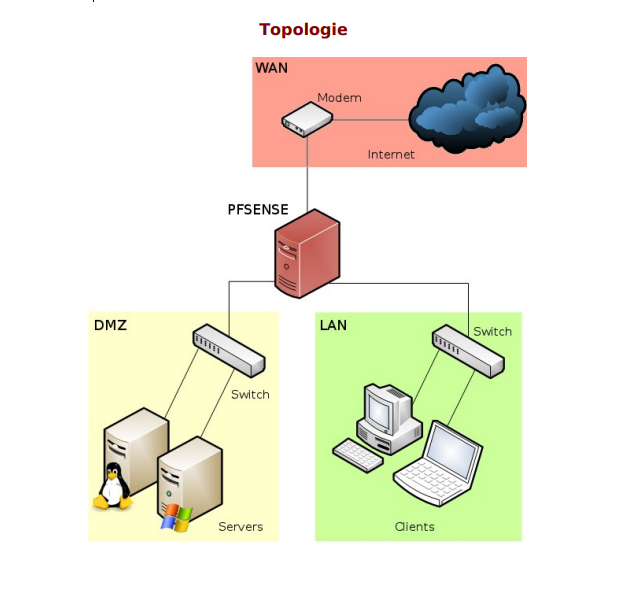

# TP PfSense / Addon

Vanhee Jean

<aside>
✏️

## Mise en place d'un package sous PFSense

</aside>

<aside>
✏️

### Mise en situation 1 :

Vous venez d’installer PFSense pour la société LSL avec accès au serveur
web situé dans la DMZ .Le DSI de l’entreprise souhaite maintenant pouvoir
monitorer via un navigateur le maximum d’informations concernant le
réseau LAN

</aside>

<aside>
✏️

#### Etape 1 :  Proposer une solution de monitoring adaptée à PFSense ,argumenter votre choix

</aside>

### Tableau des avantages de ntopng pour pfSense :

| Avantage | Pourquoi c'est utile avec pfSense |
| --- | --- |
| **Package natif** | Installé depuis System > Package Manager, maintenu pour pfSense, aucune installation externe. |
| **Aucun serveur supplémentaire** | Tout tourne sur le pare-feu, donc pas de VM ni de base de données à gérer. |
| **Voit tout le trafic du LAN** | pfSense est le point de passage obligatoire : ntopng voit tous les flux entrants et sortants. |
| **Interface web intégrée** | Accessible par navigateur (port 3000), ce qui correspond à la demande du DSI. |
| **Détail par hôte** | Pour chaque poste : débit, connexions, destinations, volume échangé. |
| **Détail par protocole** | Reconnaît HTTP, HTTPS, DNS, YouTube, Facebook, etc. (analyse DPI). |
| **Top talkers** | Identifie immédiatement qui consomme la bande passante. |
| **Temps réel** | Le DSI voit ce qui se passe maintenant sur le réseau. |
| **Choix de l'interface** | On peut surveiller le LAN, mais aussi la DMZ ou le WAN. |
| **Alertes de base** | Détection d'anomalies (scan de ports, flux suspects). |
| **Gratuit** | La version communautaire suffit pour le TP. |
| **Intégré aux règles de pare-feu** | Une seule règle sur le LAN pour autoriser l'accès à l'interface. |

 Nous avons retenu ntopng car il s'installe directement sous pfSense sous forme de package, ne nécessite aucun serveur supplémentaire, et fournit via une interface web une vue détaillée du trafic du LAN (par hôte, par protocole, en temps réel). Il répond donc précisément au besoin du DSI

<aside>
✏️

#### Etape2 : Mettre en place la solution retenue puis valider

</aside>

Installation de ntopng : 
Pour cela le pfsense doit avoir acces a internet par le WAN comme nous avons mis en place dans le précèdent TP pour télécharger les paquet 

Pour cela nous devons aller dans l’onglet Systhem —> package manager —> available packages 

ensuite descender en bas de la page jusqu’a trouver “ntopng”

Installation de ntopng :

nous allons ensuite aller dans l’onglet Diagnostics —> ntopng

ensuite mettre un mot de passe pour l’utilisateur admin :

 dans l’onglet diagnostics —> nto png 

connexion a nto png : 

Nous avons bien acces a nto png avec les identifiants et mot de passe  (admin mdp : mdpadmin)

nous pouvons dans nto png voir les différent flows 

a quoi sa sert ? 
Les flows dans ntopng servent à voir qui communique avec qui sur votre réseau, combien de données passent, et si quelque chose d’anormal se produit.

Mise en placec d’un serveur Windows sur la DMZ 
Nous ajoutons donc la carte réseaux de notre DMZFirewall > NAT > Port Forward > Add

Activation du RDP :

Nous allons allez dans l’onglet Firewall > NAT > Port Forward > Add
pour ajouter une regle qui permet d’accéder a la dmz depuis le protocole RDP

Nous allons maintenant tester le connexion du bureau a distance depuis un machine sur le WAN  en .20 

Nous mettons donc l’adresse de notre WAN avec le protocole que nous avons définis dans la regles (ici 3377)

Nous atterisson bien sur la machine Windows server de la DMZ comme voulu !

