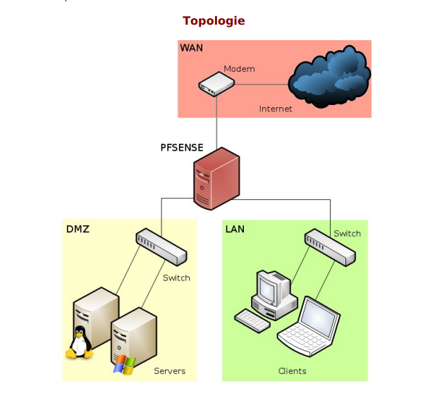
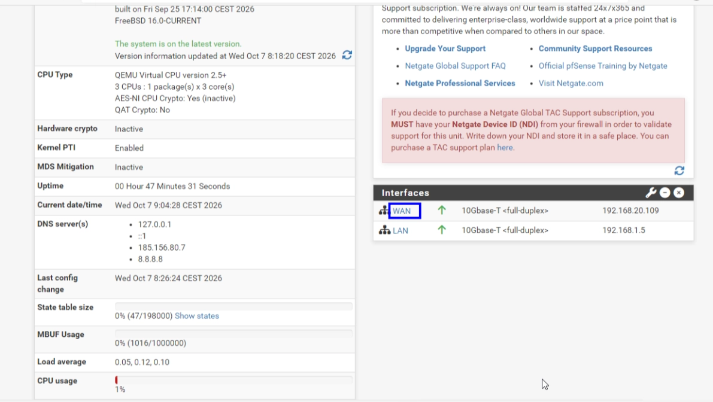
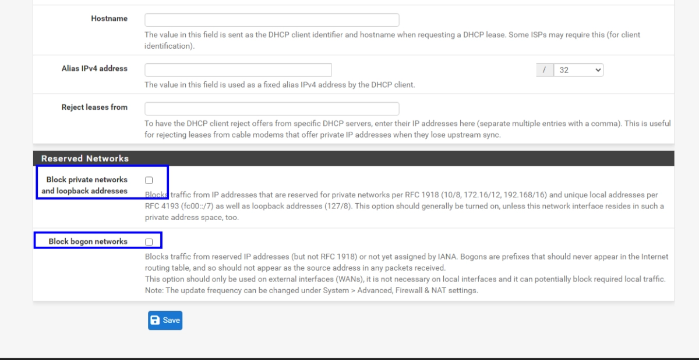

# TP PfSense / DMZ

<aside>
✏️

## Mise en place d'une architecture DMZ

</aside>

<aside>
✏️

### Mise en situation :

La société Vikor désire installer un serveur Web au sein de son
architecture réseau ,ce serveur doit être accessible depuis le LAN de
l’entreprise ainsi que de « l’extérieur » ,à savoir internet.
Afin de sécuriser au maximum son réseau ,le choix de PfSense a été fait
en raison de sa flexibilité et du nombre de fonctionnalités disponibles.

</aside>

<aside>
✏️

#### Travail demandé
ATTENTION : Vous déposerez ,pour la date indiquée par l’enseignant sur
la plateforme Moodle ,un compte rendu faisant clairement apparaître vos
choix ainsi que la démarche détaillée de toutes vos manipulations et
commandes ayant permis d’aboutir à la matérialisation du cahier des
charges ,ce document doit être exploitable par le technicien d’astreinte en
cas de problème.

</aside>

<aside>
✏️

#### Etape 1 : Installer PfSense sur une VM dotée de 3 interfaces : LAN,DMZ,Internet

</aside>

Création de la carte LAN et DMZ (bridge)

installation de PfSenses 

adressage des IP : le numero 2 (set interface ip adresse) —> choisisser l’interface que vous voulez (LAN / OPT1) puis passer a l’adressage de l’ip 

choisissez

- IPv4 via DHCP : **n**
- Adresse : `192.168.X.X`, masque : `24`
- Passerelle : vide (Entrée)
- IPv6 : **n**, puis Entrée
- DHCP server : **n**

Création de la VM client et ajout de la carte  réseaux LAN dessus pour que la vm recois une ip en 192.168.1.X 

Vérification : 

l’ip de la vm a bien une ip en 1.X !

Connexion au pfSense : 

Nous avons bien accès au Pfsense en mettant l’adresse du LAN 

Nous avons bien acces au Pfsense avec admin/pfsense

Mise en place du serv apache connecté a la DMZ  (VM apache-pfsense):

 d’abord nous allon mettre comme carte réseaux le LAN 

Ensuite  nous allons mettre l’ip qui correspond a la DMZ (192.168.2.X) car nous voullons quelle soit connecté a elle et la passerelle sera donc celle de la DMZ 192.168.2.5 

Installation de apache sur la VM : 

étape 3 : Configurer PfSense afin de rendre votre serveur Web accessible depuis
votre LAN et Internet.

Débloquer le WAN 

Pourquoi : par défaut, pfSense bloque tout ce qui arrive sur le WAN depuis une adresse privée (192.168.x.x), car sur un vrai Internet ces adresses sont suspectes. Ici, votre « Internet » est la salle en 192.168.20.x, donc il faut désactiver ce blocage.

aller dans l’interface WAN :

Ensuite descendez en bas de la page et décocher  “Block private” et “block bogon” puis save —> apply change 

de plus activer l’interface DMZ et mettre l’ip qui correspond 

nous allons maintenant configurer le PfSense pour avoir un accès depuis le LAN : 

configuration du port forward : 
Pourquoi : le serveur a une IP privée (192.168.2.10) que les autres PC de la salle ne peuvent pas joindre directement. Ils ne voient que l'IP WAN de pfSense (192.168.20.109). Le port forward dit à pfSense : « tout ce qui arrive sur mon WAN au port 80, envoie-le au serveur web ».

Pour faire ceci nous allons aller dans l’onglet Firewall —> NAT —> port forward —> bouton add 

ensuite nous atterrissons sur cette page et nous allons la modifier comme ceci 
l’ip dans redirect target ip est celle de la DMZ et nous allons accepter seulement le port http pour plus de sécurité 

Une règle se créer automatiquement ou nous voyons bien qu’il accepte seulement le port 80 HTTP

configuration du LAN :

Pourquoi **:** le LAN et la DMZ sont deux réseaux directement connectés à pfSense. Il n'y a pas de NAT à faire, seulement une règle de pare-feu qui autorise le passage.

L'accès LAN vers le serveur web est assuré par la règle « Default allow LAN to any rule ». Le LAN et la DMZ sont deux réseaux directement connectés à pfSense, donc le trafic est simplement routé

TEST : 

nous allons donc tester et nous connecter a la page de PfSense avec la VM client (192.168.1.6) en mettant l’ip de la DMZ (192.168.2.5)

nous arrivons bien a nous connecter sur la page de PfSense donc l’acces au LAN est validé !

nous allons voir aussi si on peut accéder a la page apache 

Nous avons bien acces a la page apache a partir de la machine client dans le LAN 

Pour finir nous allons tester si on peut acceder a la page apache a partir d’un PC dans la salle (WAN)

nous atterrissons sur la page apache comme prévu avec une ip dhcp que internet (la salle nous a donné) !!